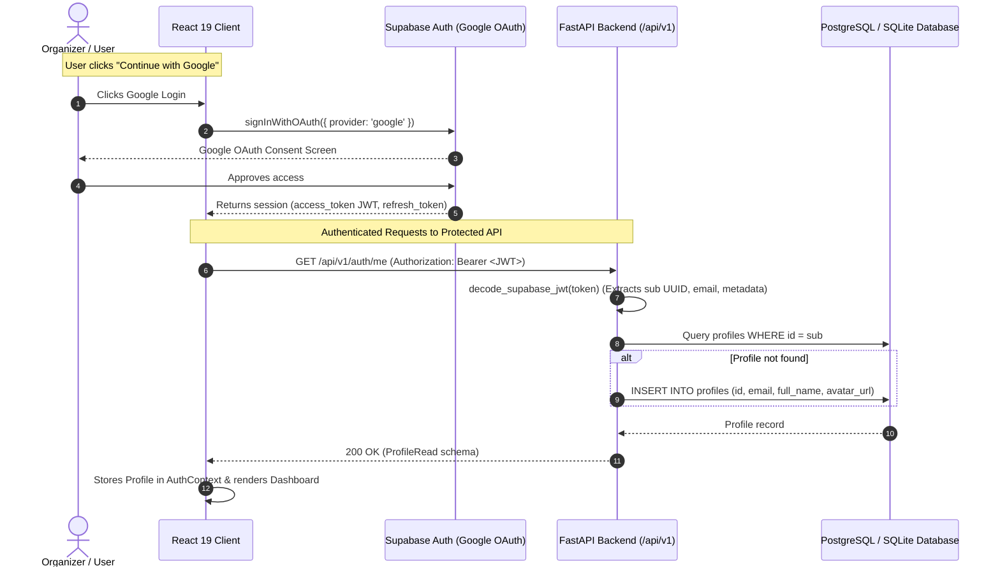
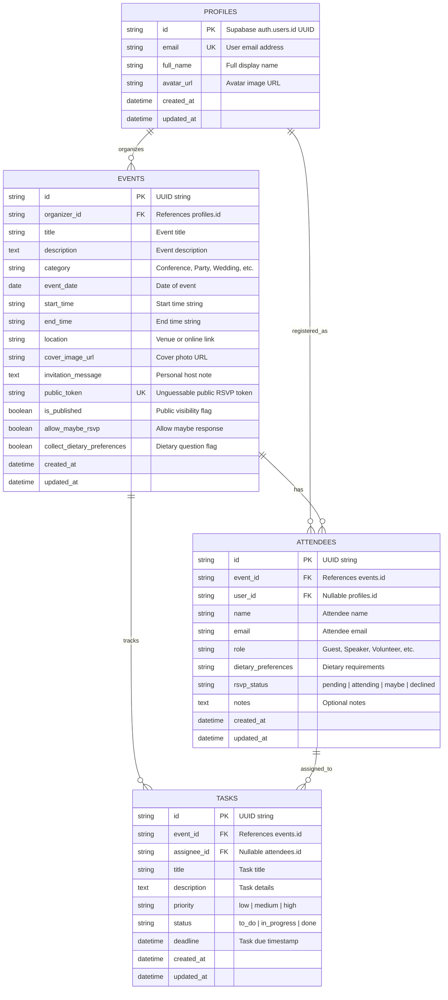

# Event Pro — Full-Stack Event Planning Platform

> **Live Project Status**: `Phase 7 Complete — AI Event Planning Copilot & All Core SaaS Milestones Realized`  
> **Last Updated**: `2026-11-02`  
> **Platform Status**: `Production-Ready MVP (All 7 Phases Complete)`

---

## 📌 Living Documentation Policy

This `README.md` serves as the **single source of truth** for Event Pro. It is maintained and updated **on-the-go** after every phase and architectural milestone to reflect:
1. Exact system architecture and directory layouts.
2. Implemented features vs. upcoming roadmap items.
3. Live Changelog with timestamped progression.
4. Active environment configurations and run instructions.

---

## 📊 Phase Roadmap & Current Progress

| Phase | Focus Area | Status | Deliverables |
|---|---|:---:|---|
| **Phase 1** | **Project Foundation** | **✅ Done** | React 19 + Vite + Tailwind v4 + shadcn shell, FastAPI backend, Health Check API, Vite proxy, Living README |
| **Phase 2** | **Auth & Database Schema** | **✅ Done** | Supabase Auth, Google OAuth flow, SQLAlchemy 2.0 async models, Alembic migrations, Protected routes, AuthContext |
| **Phase 3** | **Event Management CRUD** | **✅ Done** | Event creation with live preview, event editing, deletion, event catalog, detail overview, live dashboard KPI integration |
| **Phase 4** | **Guest Management & RSVP** | **✅ Done** | Attendee roster, CSV bulk import, role assignment, dietary tracking, inline RSVP toggle, email copy |
| **Phase 5** | **Public Invitation Experience** | **✅ Done** | Unguessable token routes (`/e/:token`), public RSVP form, real-time response syncing, calendar add |
| **Phase 6** | **Task Collaboration** | **✅ Done** | Interactive 3-column Kanban board, assignee lookup, priority badges, deadline tracking, cross-event task workspace |
| **Phase 7** | **AI Event Planning Copilot** | **✅ Done** | Automated task generation, 1-click batch Kanban creation, tone copywriter, run-of-show agenda generator |

---

## 🔐 Authentication Architecture & Flow



---

## 🗄️ Database Schema (Entity-Relationship Model)



---

## 🛠️ Technology Stack Details

| Layer | Component | Version / Tools | Purpose |
|---|---|---|---|
| **Frontend Framework** | React + TypeScript | React 19, TypeScript 5.8+, Vite 8 | High-performance SPA with strict typing |
| **Authentication** | Supabase Auth | `@supabase/supabase-js` v2 | Google OAuth, email/password sessions, JWT persistence |
| **Styling & Design** | Tailwind CSS + Radix UI | Tailwind v4, `@tailwindcss/vite`, CVA | Custom Warm Professional design tokens |
| **Client Routing** | React Router | `react-router-dom` v7 | Client-side routing, protected routes, nested layouts |
| **Server State** | TanStack Query | `@tanstack/react-query` v5 | Caching, background synchronization, loading/error states |
| **HTTP Client** | Axios | `axios` v1 | Auto-attaches Supabase Bearer token via request interceptors |
| **Backend Framework** | Python + FastAPI | Python 3.14, FastAPI 0.115+, Uvicorn | Async REST API, OpenAPI docs, strict validation |
| **Configuration** | Pydantic Settings | `pydantic-settings` v2 | Type-safe environment variable parsing |
| **Database & Auth** | Supabase / SQLite | Supabase PostgreSQL + asyncpg (or aiosqlite dev fallback) | Managed PostgreSQL with RLS policies |
| **ORM & Migrations** | SQLAlchemy 2.0 & Alembic | `sqlalchemy[asyncio]`, Alembic | Relational models and revision migrations |

---

## 📂 Active Project Structure

```
Event-Pro/
├── .agents/skills/                   # UI/UX design skills (Agent Skills standard)
│   ├── frontend-design/             # Design lead & 10 doctrine reference documents
│   ├── setup/                       # Design context persister
│   ├── add-ui/                      # Multi-variation component generator
│   ├── critique/                    # Qualitative UX auditor
│   └── a11y/                        # WCAG 2.1 AA accessibility inspector
├── .better-web-ui.md                 # Design system contract (colors, fonts, radii, spacing)
├── .gitignore                        # Global ignore (.venv, node_modules, .env, dist)
├── README.md                         # Living Project Documentation & Roadmap (THIS FILE)
│
├── frontend/                         # React 19 + TypeScript + Vite
│   ├── src/
│   │   ├── components/
│   │   │   ├── ai/                  # AITaskGeneratorModal, AIToneAssistantModal, AIAgendaModal
│   │   │   ├── attendees/           # AttendeeTable, AddAttendeeModal, ImportCsvModal
│   │   │   ├── events/              # EventCard, InvitationPreview, InvitationMediaShowcase
│   │   │   ├── tasks/               # KanbanBoard, TaskCard, TaskModal
│   │   │   ├── layout/              # PageShell, Sidebar, TopBar, MobileNav, ProtectedRoute
│   │   │   ├── shared/              # ErrorBoundary, EmptyState, LoadingState (Skeletons)
│   │   │   └── ui/                  # shadcn/Radix primitives (Button, Card, Avatar, Progress, Separator)
│   │   ├── context/                 # AuthContext (Supabase Google OAuth + persistent session state)
│   │   ├── lib/
│   │   │   ├── api.ts               # Axios client with auto-injected Bearer token & full API SDK
│   │   │   ├── supabase.ts          # Supabase client with defensive URL validation
│   │   │   └── utils.ts             # cn() tailwind-merge helper & date formatters
│   │   ├── pages/                   # LoginPage, PublicInvitationPage, DashboardPage, EventsPage, CreateEventPage, EventDetailPage, TasksPage, SettingsPage
│   │   ├── App.tsx                  # Client router with AuthProvider, public /e/:token, & ProtectedRoute
│   │   ├── main.tsx                 # Providers (QueryClientProvider, BrowserRouter, ErrorBoundary)
│   │   └── index.css                # Tailwind v4 theme & CSS variable design tokens
│   ├── vite.config.ts               # Path aliases (@/) & /api + /uploads proxy to FastAPI
│   └── tsconfig.json                # Strict TypeScript configuration
│
└── backend/                          # FastAPI + Python 3.14
    ├── alembic/                      # Alembic schema migrations
    │   ├── versions/
    │   │   └── 001_initial_schema.py # Initial migration (profiles, events, attendees, tasks)
    │   └── env.py                   # Async migration runner
    ├── app/
    │   ├── api/
    │   │   ├── deps.py              # Security dependencies: get_current_user, get_current_user_optional
    │   │   └── v1/
    │   │       ├── auth.py          # GET /api/v1/auth/me, PATCH /api/v1/auth/me
    │   │       ├── events.py        # POST /api/v1/events, GET /events, GET /events/:id, PUT, DELETE, GET /dashboard/stats, GET/POST public RSVP
    │   │       ├── attendees.py     # Attendee CRUD, CSV bulk import, role assignment, RSVP toggle
    │   │       ├── tasks.py         # Task CRUD, Kanban status transition, attendee assignment, stats
    │   │       ├── ai.py            # AI task generation, batch Kanban create, tone writer, agenda generator
    │   │       ├── upload.py        # Direct file upload endpoint (images, PDFs)
    │   │       └── health.py        # GET /api/v1/health
    │   ├── core/
    │   │   ├── config.py            # Pydantic Settings (reads .env, parses CORS, typed configs)
    │   │   ├── database.py          # Async SQLAlchemy engine, auto-sanitizing password encoder, init_db
    │   │   └── security.py          # Multi-algorithm Supabase JWT decoder (RS256/ES256/HS256)
    │   ├── models/                  # Base, Profile, Event, Attendee, Task (SQLAlchemy 2.0 ORM)
    │   ├── schemas/                 # Profile, Event, Attendee, Task, AI schemas (Pydantic)
    │   └── main.py                  # FastAPI initialization, CORS middleware, static /uploads mount
    ├── supabase_setup.sql           # Master 1-click database & RLS setup script for Supabase SQL Editor
    ├── requirements.txt             # Pinned backend dependencies
    └── .env.example                 # Backend environment template
```

---

## 🚀 Getting Started & Local Development

### 1. Prerequisites
- **Node.js** v20+ and **pnpm** (`npm install -g pnpm`)
- **Python** 3.11+ (Python 3.14 verified)

---

### 2. Backend Setup & Startup

```powershell
cd d:\Event-Pro\backend

# 1. Activate the Python virtual environment
.venv\Scripts\activate

# 2. Launch the FastAPI server with auto-reload
uvicorn app.main:app --reload --port 8000
```

- **Interactive Swagger Docs**: [`http://localhost:8000/docs`](http://localhost:8000/docs)
- **Health Check Endpoint**: [`http://localhost:8000/api/v1/health`](http://localhost:8000/api/v1/health)
- **Events API**: [`http://localhost:8000/api/v1/events`](http://localhost:8000/api/v1/events)
- **Dashboard Stats**: [`http://localhost:8000/api/v1/dashboard/stats`](http://localhost:8000/api/v1/dashboard/stats)

---

### 3. Frontend Setup & Startup

```powershell
cd d:\Event-Pro\frontend

# 1. Launch Vite development server
pnpm dev
```

- **Web Application**: [`http://localhost:5173`](http://localhost:5173)
- **Create New Event**: [`http://localhost:5173/events/new`](http://localhost:5173/events/new)
- **Events Catalog**: [`http://localhost:5173/events`](http://localhost:5173/events)

---

## 📝 Continuous Changelog

```
[2026-11-02] — Unified Luxury Invitation Suite & Auto-Fit PDF Presentation
- Unified Invitation Experience (Eliminated Disjointed Two-Card Layout):
  * Merged the separate invitation artwork card, logistics section, and RSVP submission form into ONE continuous, seamless luxury invitation suite on `/e/:token` and in live previews.
  * Styled the RSVP section as an integrated matching RSVP response slip right beneath the celebration details.
  * Replaced technical document viewer chrome ("Multi-page invitations, schedules & wedding brochures", redundant badges) with floating minimalist full-view controls.
- Eliminated Dark Sidebars / Pillarbox Spacing in PDF Invitations:
  * Injected `#toolbar=0&navpanes=0&scrollbar=0&view=FitH` to force the browser PDF viewer to scale 100% horizontally.
  * Re-architected container to a natural portrait card aspect ratio (`aspect-[1/1.38]` with `max-w-xl mx-auto`), allowing portrait wedding invitations to fill the container edge-to-edge with zero black space.
- Verified TypeScript build clean (1.85s).

[2026-11-02] — Invitation Media UX Fixes: Canva Showcase & Document Upload Cards
- Resolved Canva iframe restriction ("refused to connect"):
  * Canva enforces strict X-Frame-Options: SAMEORIGIN on non-embed links.
  * Rebuilt `InvitationMediaShowcase` with dual modes:
    - Default Presentation Card: A branded Canva hero card with direct "Open & Flip Canva Invitation ↗" button that never fails or shows broken browser iframes.
    - Embedded Player: User can toggle to embed mode with full-screen action and guidance banner.
  * Enhanced Canva URL parser `formatCanvaUrl` to automatically normalize `/edit` and `/watch` URLs to Canva view parameters.
  * Added step-by-step guidance in `CreateEventPage` explaining public view link setup and recommending PNG/PDF download for 100% native embedding.
- Re-architected File Upload UX in `CreateEventPage`:
  * Resolved the issue where uploading a PDF or image merely placed raw `/uploads/...` URL text into an input box.
  * Replaced the raw text box with an "Attached Document Card" (PDF) and "Attached Image Card" (Photo):
    - Shows original file name (strips server uuid prefix).
    - Status badge: "Official invitation PDF attached & ready".
    - 1-click "Preview Document ↗" and "Remove" actions.
    - Completely hides the raw URL input when a file is actively attached.
  * Updated backend `POST /api/v1/upload` and schema `UploadResponse` to return `original_filename`.
  * Verified TypeScript build clean (1.94s).

[2026-11-02] — Phase 7: AI Event Planning Copilot Complete (All 7 Phases Realized)
- Created Pydantic AI schemas (GenerateTasksRequest, SuggestedTask, GenerateTasksResponse, BatchCreateTasksRequest, GenerateInvitationRequest, GenerateInvitationResponse, GenerateAgendaRequest, GenerateAgendaResponse).
- Implemented AI API endpoints in backend/app/api/v1/ai.py:
  * POST /api/v1/ai/generate-tasks (Gemini/OpenAI powered with expert offline domain template engine)
  * POST /api/v1/ai/batch-create-tasks (1-click bulk insertion of suggested tasks into the event Kanban board)
  * POST /api/v1/ai/generate-invitation (tone copywriter: warm, formal, casual, festive, poetic)
  * POST /api/v1/ai/generate-agenda (chronological run-of-show schedule builder)
- Built interactive frontend AI Copilot components:
  * AITaskGeneratorModal: Checkable suggested preparation checklist with count selector (5, 8, 10 tasks), priority badges, due-date offsets, and 1-click batch Kanban creation.
  * AIToneAssistantModal: 5 tone selectors with custom detail prompts and live 1-click apply to the event's invitation message.
  * AIAgendaModal: Run-of-show timeline with milestone sequence numbers, timestamps, and copy-to-clipboard action.
- Integrated AI assistants into KanbanBoard ("AI Task Copilot" button), CreateEventPage ("AI Tone Assistant"), and EventDetailPage ("Generate AI Run-of-Show").
- Verified clean TypeScript build (2.36s).

[2026-11-02] — Feature: Rich Invitation Media (Canva, PDF & Photo Uploads)
- Added support for Canva interactive presentation embeds, PDF multi-page documents, and high-res digital wedding/party cards.
- Built backend POST /api/v1/upload endpoint for direct file uploads (PNG, JPG, WebP, PDF) up to 15MB.
- Mounted FastAPI /uploads static file server with Vite dev proxy.
- Added invitation_media_url and invitation_media_type to Event models, schemas, and database initialization.
- Built `InvitationMediaShowcase` component providing responsive Canva player, PDF viewer with download button, and ornate wedding card showcase with zoom lightbox.
- Enhanced CreateEventPage with a 3-tab media selector and drag-and-drop file uploader.
- Integrated InvitationMediaShowcase into PublicInvitationPage (/e/:token) right above the interactive RSVP form.

[2026-11-02] — Fix: Supabase Asymmetric JWT Decoding
- Fixed `Invalid authentication credentials: The specified alg value is not allowed` on event creation.
- Supabase Auth issues `RS256` / `ES256` tokens for OAuth (Google Sign-In). Updated `backend/app/core/security.py` to inspect the token's unverified header algorithm, support `[HS256, RS256, ES256, PS256]`, and safely decode user identity and profile claims.

[2026-11-02] — Phase 6: Task Collaboration & Kanban Board Complete
- Created Pydantic Task schemas (TaskCreate, TaskUpdate, TaskRead, TaskStats).
- Implemented Task REST API endpoints in backend/app/api/v1/tasks.py:
  * GET /api/v1/events/{id}/tasks (with status & priority filtering and eager loaded assignee)
  * POST /api/v1/events/{id}/tasks (create task with assignee validation against event roster)
  * PUT /api/v1/events/{id}/tasks/{task_id} (update status, priority, assignee, deadline)
  * DELETE /api/v1/events/{id}/tasks/{task_id} (remove task)
  * GET /api/v1/events/{id}/tasks/stats (computed completion percentage & breakdown)
  * GET /api/v1/tasks/my (cross-event organizer tasks)
- Built interactive frontend task components:
  * TaskCard: Priority badges (high/medium/low), overdue alerts, assignee avatar, 1-click status movement buttons (Start, Mark Done, Reopen), edit/delete actions.
  * TaskModal: Dialog for creating/editing tasks with attendee assignee picker and deadline input.
  * KanbanBoard: 3-column board (To Do, In Progress, Completed), search filter, priority filter, and progress bar.
- Connected KanbanBoard into EventDetailPage ("Tasks" tab) and built dedicated cross-event workspace in TasksPage.
- Verified TypeScript build clean (1.12s).

[2026-11-02] — Phase 5: Public Invitation Experience & Guest RSVP Complete
- Implemented public endpoints in backend/app/api/v1/events.py:
  * GET /api/v1/events/public/{token}: Unauthenticated event lookup by unguessable token.
  * POST /api/v1/events/public/{token}/rsvp: Public RSVP submission (creates or updates attendee with name, email, dietary preferences, notes, and RSVP status).
- Built frontend PublicInvitationPage at route `/e/:token`:
  * Editorial Serif layout with category badge, host note, venue/virtual links, and date/time info.
  * Interactive RSVP response selector (Attending, Maybe if allowed, Can't Make It).
  * Dietary requirements and custom note inputs.
  * Confirmed response state with celebratory message and "Add to Google Calendar" button.
- Wired unauthenticated `/e/:token` route in App.tsx.
- Tested production frontend build clean.

[2026-11-02] — Phase 4: Guest Management & RSVP Tracking Complete
- Created Pydantic Attendee schemas (AttendeeCreate, AttendeeUpdate, AttendeeRead, AttendeeCSVImportResult, AttendeeStats).
- Implemented attendee API endpoints in backend/app/api/v1/attendees.py:
  * GET /api/v1/events/{id}/attendees (supports status filtering: all, attending, maybe, declined, pending)
  * POST /api/v1/events/{id}/attendees (add individual attendee with role, dietary restrictions, notes)
  * PUT /api/v1/events/{id}/attendees/{attendee_id} (update attendee fields, inline RSVP status toggle)
  * DELETE /api/v1/events/{id}/attendees/{attendee_id} (remove attendee)
  * GET /api/v1/events/{id}/attendees/stats (live headcount by RSVP status)
  * POST /api/v1/events/{id}/attendees/import-csv (bulk CSV import with auto deduplication and validation error reporting)
- Built interactive frontend guest management components:
  * AddAttendeeModal: Dialog to add attendee with role selection, dietary preferences, and custom notes.
  * ImportCsvModal: Bulk CSV file uploader with downloadable template, parsing preview, and import feedback.
  * AttendeeTable: Interactive table with search, role badges, dietary restriction chips, 1-click email copy, inline RSVP status dropdown, and deletion with confirmation.
- Integrated AttendeeTable directly into EventDetailPage's "Guest List" tab.
- Tested production frontend build (`pnpm run build`) passing cleanly in 2.18s.

[2026-11-02] — Phase 3: Event Management CRUD Complete
- Created Pydantic Event schemas (EventCreate, EventUpdate, EventRead, DashboardStats) with validation.
- Implemented FastAPI CRUD endpoints: POST /api/v1/events, GET /events, GET /events/{id}, PUT /events/{id}, DELETE /events/{id}.
- Built GET /api/v1/dashboard/stats computing live KPIs (upcoming events, confirmed attendees, pending RSVPs, task readiness).
- Built GET /api/v1/events/public/{token} for unauthenticated public invitation views.
- Created `EventCard` component with date tile, category pill, venue location, attendee badge, and 1-click link copier.
- Created `InvitationPreview` component providing interactive real-time preview of guest invitation card.
- Built `CreateEventPage` supporting both event creation and editing with two-column responsive layout and live preview.
- Built `EventsPage` with search bar, tab filtering (Upcoming / Past / All), and empty states.
- Built `EventDetailPage` command center displaying public invitation link banner, key stats, logistics, and tabs.
- Connected `DashboardPage` to real TanStack Query hooks for live KPI metrics and upcoming event lists.
- Verified clean TypeScript build (1.81s) and verified all backend endpoints.

[2026-11-02] — Phase 2: Authentication & Database Schema Complete
- Configured Supabase Auth with Google OAuth client and persistent session handling.
- Built React AuthContext with session persistence, Google Sign-In, and login/register tabs.
- Created LoginPage matching the Warm Professional design system.
- Added ProtectedRoute navigation guard for all organizer pages (/dashboard, /events, /tasks, /settings).
- Updated TopBar with authenticated user identity chip (avatar, name, email) and sign-out button.
- Updated Dashboard greeting to dynamically display the authenticated user's first name.
- Configured Axios request interceptor to auto-inject Supabase Bearer JWT tokens into all API calls.
- Designed SQLAlchemy 2.0 async domain models: Profile, Event, Attendee, Task.
- Created Alembic async migration version `001_initial_schema.py`.
- Wrote `backend/supabase_setup.sql` master database script.
- Implemented backend security dependency `get_current_user` in `backend/app/api/deps.py` with automatic profile synchronization.
- Created `/api/v1/auth/me` endpoints for profile retrieval and updates.
- Verified TypeScript build clean (1.53s) and verified in-memory schema generation across all 4 tables.
- Fixed blank screen issue: Added defensive URL sanitation in `frontend/src/lib/supabase.ts` preventing `TypeError: Invalid URL` on placeholder environment variables, and installed root `ErrorBoundary` in `main.tsx`.

[2026-11-02] — Phase 1: Foundation Established
- Installed Agent Skills into `.agents/skills/`.
- Authored canonical design specification `.better-web-ui.md`.
- Scaffolded React 19 + TypeScript + Vite frontend with Tailwind CSS v4 and Radix UI primitives.
- Built responsive layout system (PageShell, Sidebar, TopBar, MobileNav).
- Implemented Dashboard shell with TanStack Query health check badge and KPI stat cards.
- Scaffolded FastAPI backend with Pydantic BaseSettings, CORS middleware, and `/api/v1/health` endpoint.
- Configured Vite development reverse proxy to eliminate CORS during local development.
- Initialized living README with architecture and live update tracking protocol.
```
